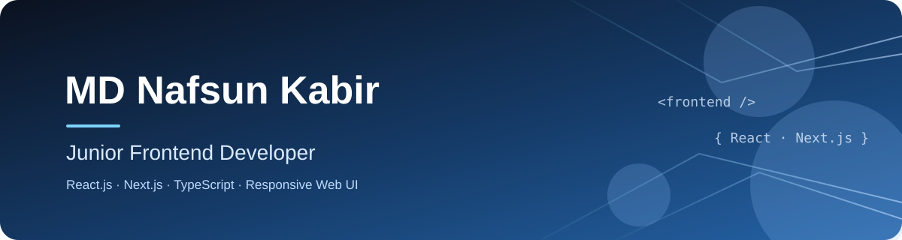

  

<h2 align="center">Hi, I'm MD Nafsun Kabir</h2>
<h3 align="center">Junior Frontend Developer</h3>

  Computer Science and Engineering graduate from Bangladesh Army University of Science and Technology (BAUST), interested in building modern, responsive, and user-friendly web applications.

---

## About Me

- I enjoy creating responsive interfaces and practical web applications.
- I am continuously improving my skills in React.js, Next.js, and TypeScript.
- I am exploring modern frontend practices, API integration, and AI-assisted development.
- I build personal projects to strengthen my development and problem-solving skills.

## Tech Stack

  

## Featured Projects

### [Rangpur Rental Client — Equipment Rental Marketplace](https://github.com/Nafsun-baust/rangpur-rental-client)
A responsive equipment-rental marketplace where equipment owners can list items and customers can browse, book, and pay online.

- Browse equipment with search, filters, and sorting.
- Supports role-based authentication for customers, owners, and admins.
- Includes equipment details, favorites, booking flow, and Stripe checkout.
- Provides customer, owner, and admin dashboards with analytics.
- **Stack:** Next.js, React, Better Auth, MongoDB, Stripe, Framer Motion, Recharts, Tailwind CSS.
- [Live Demo](https://rangpur-rental-client.vercel.app/) · [Client Source Code](https://github.com/Nafsun-baust/rangpur-rental-client) · [Server Repository](https://github.com/Nafsun-baust/rangpur-rental-server)

### [FitLog — Workout Planner](https://fitlog-nafsun.vercel.app/)
A workout planning application for exploring exercises and organizing daily workout routines.

- Browse exercises by muscle group and view workout instructions.
- Build a daily plan, save exercises, and track completion.
- **Stack:** Next.js, React, TypeScript, Tailwind CSS, Context API.
- [Live Demo](https://fitlog-nafsun.vercel.app/) · [Source Code](https://github.com/Nafsun-baust/fitlog)

### [Dev Stack — Technology Stack Builder](https://silver-sundae-b2e30c.netlify.app/)
An interactive tool for exploring development technologies and building a personalized technology stack.

- Explore technologies by category and add them to a custom stack.
- Prevent duplicate selections, remove items, or clear the stack.
- **Stack:** React, TypeScript, Vite, Tailwind CSS.
- [Live Demo](https://silver-sundae-b2e30c.netlify.app/) · [Source Code](https://github.com/Nafsun-baust/dev-stack)

## GitHub Statistics

  
  

  

## Connect With Me

  
  
  

  <b>Email:</b> <a href="mailto:nafsunkabirk@gmail.com">nafsunkabirk@gmail.com</a> 
  <b>Location:</b> Rangpur, Bangladesh

